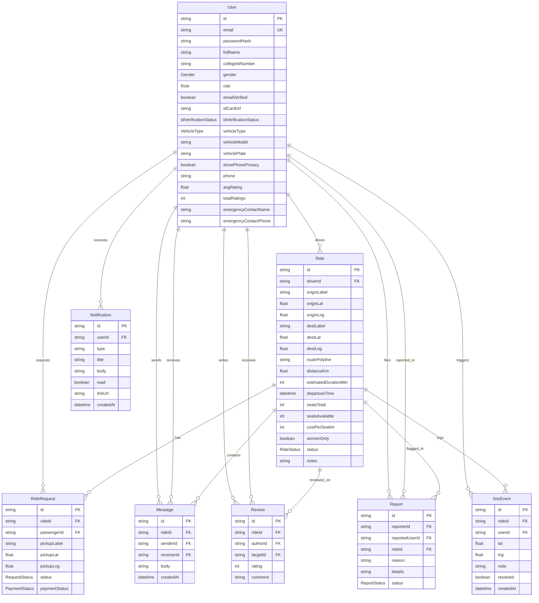
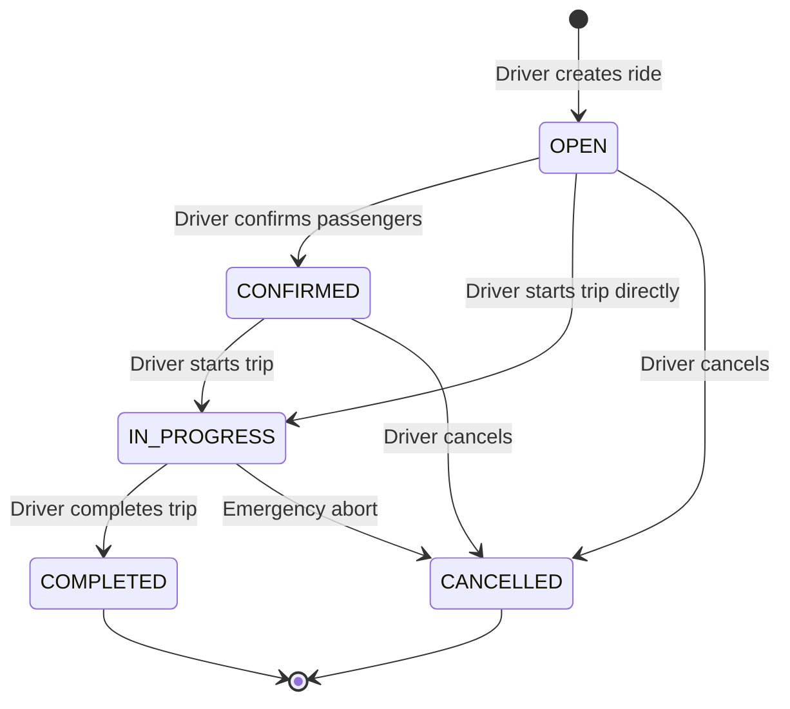

# RideMate — System Architecture

## 1. Overview
**RideMate** is a zero-cost, mobile-first student carpooling web application built with **Next.js 16 (App Router)**, **TypeScript (`strict: true`)**, **Tailwind CSS v4**, and **PostgreSQL via Prisma ORM 7**. All mapping, geocoding, and routing run on free, open infrastructure (OpenStreetMap tiles, Nominatim, and public OSRM with graceful Haversine fallbacks). All measurements are strictly **metric** (`km`, `km/h`) and currency is **INR** (`₹`).

## 2. Folder Tree
```text
.
├── prisma/
│   ├── schema.prisma          # Prisma 7 PostgreSQL schema (8 core models)
│   └── seed.ts                # Idempotent seed (5 demo users + 4 Bengaluru campus rides)
├── prisma.config.ts           # Prisma 7 CLI & datasource configuration
├── public/
│   ├── manifest.json          # PWA Web App Manifest
│   └── icons/                 # SVG PWA icons
├── src/
│   ├── app/
│   │   ├── layout.tsx         # Root layout, ThemeProvider, AppShell
│   │   ├── globals.css        # Tailwind v4 + theme tokens + Leaflet overrides
│   │   ├── page.tsx           # Landing page
│   │   ├── login/page.tsx     # Login page + demo credentials shortcut
│   │   ├── register/page.tsx  # College email registration + mock 6-digit OTP
│   │   ├── find/page.tsx      # Search & compatibility-ranked ride discovery
│   │   ├── offer/page.tsx     # Interactive map ride creation + fuel split estimator
│   │   ├── trips/page.tsx     # Driver & passenger trips dashboard
│   │   ├── rides/[id]/page.tsx# Ride detail, lifecycle, map/tracking, chat, SOS, reviews
│   │   ├── profile/page.tsx   # Profile, vehicle, privacy, emergency contact, ID upload
│   │   ├── admin/page.tsx     # Admin ID verification & report moderation queue
│   │   └── api/
│   │       ├── auth/          # register, verify-otp, login, logout, me
│   │       ├── profile/       # GET/PATCH profile & ID upload
│   │       ├── admin/         # ID verifications & report moderation
│   │       ├── route/         # OSRM proxy + Haversine fallback
│   │       ├── rides/         # CRUD, match engine, status transitions
│   │       ├── requests/      # Seat request, atomic accept/reject/cancel, payment sim
│   │       ├── messages/      # Ride chat GET/POST (4s polling)
│   │       ├── notifications/ # Unread list & mark-read
│   │       ├── reviews/       # Post-ride ratings + atomic avgRating update
│   │       ├── reports/       # Safety report creation
│   │       └── sos/           # Simulated SOS event logging + notifications
│   ├── components/
│   │   ├── layout/            # ThemeProvider, AppShell, NotificationBell
│   │   └── map/               # RideMap (dynamic SSR-false), LocationAutocomplete
│   ├── lib/
│   │   ├── prisma.ts          # Prisma 7 global singleton with @prisma/adapter-pg
│   │   ├── auth.ts            # jose JWT signing/verification, HttpOnly cookie, getCurrentUser()
│   │   ├── geo.ts             # Haversine distance (km), point-to-polyline min distance (km)
│   │   ├── cost.ts            # Fuel cost estimator & per-seat INR split
│   │   ├── matching.ts        # Pure compatibility scorer & women-only enforcement
│   │   ├── presets.ts         # Bengaluru campus corridor quick-pick locations
│   │   └── __tests__/         # Vitest unit test suite
│   └── middleware.ts          # Route protection for authenticated & admin routes
├── ARCHITECTURE.md
├── AGENTS.md
├── CONTEXT.md
└── README.md
```

## 3. Entity-Relationship Diagram



## 4. Ride State Machine



## 5. Matching Algorithm (`/api/rides/match`)
1. **Hard Filters (Server-Side):**
   - Only `OPEN` (or `CONFIRMED` with `seatsAvailable > 0`) rides with `seatsAvailable >= 1`.
   - **Women-Only Enforcement:** If the authenticated requester is not `FEMALE` (or unauthenticated), rides with `womenOnly === true` are strictly excluded at both query and filter layers.
   - If the requester requests `womenOnly: true`, only female users may query `womenOnly: true` rides.
   - Time window filter: `|ride.departureTime - desiredTime| <= windowMinutes` (default `±60 min`).
2. **Spatial & Temporal Compatibility Score (`0–100`):**
   - **Pickup-to-Route Distance (`pickupDistKm`):** Minimum perpendicular distance from passenger pickup coordinates to the driver's OSRM polyline segments (falls back to `[origin, dest]` segment if polyline unavailable). Must be `<= maxPickupRadiusKm`.
   - **Destination Proximity (`destDistKm`):** Haversine distance between passenger destination and ride destination (or closest point along the final third of the route).
   - **Time Delta (`timeDeltaMin`):** Absolute minutes difference between desired departure and ride departure.
   - **Weighted Score:**
     - Route pickup fit: `45%` weight (`max(0, 1 - pickupDistKm / maxPickupRadiusKm)`)
     - Destination fit: `35%` weight (`max(0, 1 - destDistKm / max(maxPickupRadiusKm * 1.5, 5))`)
     - Time alignment: `20%` weight (`max(0, 1 - timeDeltaMin / max(windowMinutes, 1))`)
   - Rides are sorted descending by score, returning transparent match metrics (`matchScore`, `pickupDistKm`, `destDistKm`, `timeDeltaMin`).

## 6. Real vs. Simulated Scope Matrix

| Category | Features | Implementation |
| :--- | :--- | :--- |
| **Real (23)** | College email domain check, mock OTP verification (UI demo banner), HttpOnly JWT auth, middleware, profiles, vehicles, phone privacy, ID upload, Admin ID & report queues, OSM/Leaflet maps, Nominatim autocomplete, OSRM routing + Haversine fallback, offer/find/match, women-only server guard, atomic seat requests, ride state machine, 4s polling chat, notifications, fuel split (INR/km), ratings & reviews, safety reporting, responsive PWA shell. | Full PostgreSQL persistence via Prisma 7, Zod validation, atomic transactions, server-side authorization. |
| **Simulated (3 — Badged "Demo Simulation")** | 1. Live GPS tracking along OSRM polyline & ETA (`min`).<br>2. Emergency/SOS button logging `SosEvent` with simulated coordinates & participant alert notifications.<br>3. Optional payment settlement status (`UNPAID` / `SIMULATED_PAID`). | Persisted in PostgreSQL (`SosEvent`, `RideRequest.paymentStatus`) and clearly labeled with **"Demo Simulation"** UI badges. Zero paid external APIs. |
